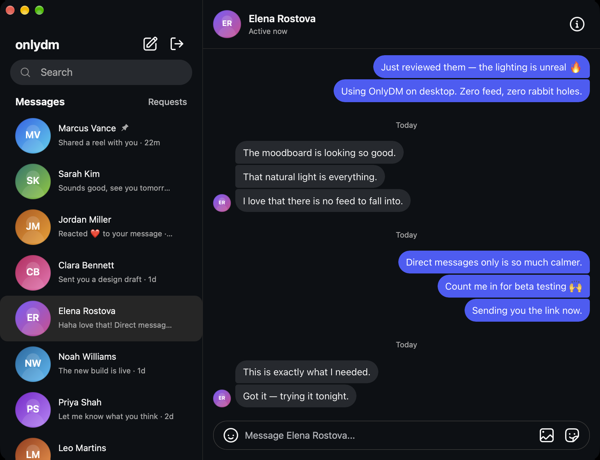

# OnlyDM — Desktop Client for Instagram DM

<p align="center">
  
</p>

<p align="center">
  <strong>OnlyDM is a lightweight desktop client for Instagram DM.</strong>
</p>

<p align="center">
  <a href="https://only-dm.vercel.app">Website</a> ·
  <a href="https://github.com/PW486/only-dm/releases/latest">Download</a> ·
  <a href="https://github.com/PW486/only-dm/issues">Issues</a>
</p>

<p align="center">
  <a href="https://github.com/PW486/only-dm/releases"></a>
  <a href="LICENSE"></a>
  <a href="https://tauri.app/"></a>
  <a href="https://www.rust-lang.org/"></a>
  
</p>

---

## Overview

Most people open Instagram on their desktop just to reply to an urgent direct message, then lose an hour to the algorithmic feed.

**OnlyDM** changes that. Built on **Tauri v2** and **Rust**, it is a fast, distraction-free desktop client dedicated to direct messaging. No explore feed, no endless reels, and no background resource hogs.

<p align="center">
  
</p>

<p align="center">
  <sub>OnlyDM on macOS with sample conversations.</sub>
</p>

---

## ✨ Features

- **Direct Messages Only**: Redirects home-feed visits back to `/direct/inbox/`, so the app always stays on messaging.
- **Featherlight Footprint**: Typically **35–55 MB of RAM** and a **~12 MB macOS installer**, with no bundled Chromium or Node.js runtime.
- **Distraction-Free Workspace**: Removes the global navigation sidebar, Notes tray, promotional banners, and extra layout padding.
- **Quiet & Calm Messaging**: Hides incoming call popups, mutes their looping ringtones, and removes call and voice-recorder buttons. Voice messages and media you receive still play normally.
- **Single-Account Focus**: Locks the account switcher so the inbox stays a one-account workspace. Log out from the app menu to switch accounts.
- **Native macOS Integration**: Native menu bar, `⌘⇧L` logout shortcut, window state restore, Dock reopen, and a localized logout dialog in 16 languages.
- **Smart Link Routing**: User profiles and external links open in your default browser, while shared posts, reels, and stories stay inside the app.
- **Privacy-Preserving**: Talks directly to official Instagram endpoints. No OnlyDM proxy, no analytics, and no telemetry in the desktop app.

---

## ⚡ Performance Comparison

| Metric | OnlyDM (Tauri v2 + Rust) | Typical Electron Client |
| :--- | :--- | :--- |
| **Idle Memory Usage** | **35 MB – 55 MB** | 400 MB – 850 MB |
| **Installer Size (macOS)** | **~12 MB (.dmg)** | 110 MB – 180 MB |
| **Cold Startup Time** | **< 400 ms** | 2.5 s – 4.0 s |
| **Runtime** | Native WebKit + Rust | Bundled Chromium + Node.js |

> Idle ranges are typical on Apple Silicon and vary with conversation count and media. Electron figures are representative ranges for popular wrappers, not benchmarks of every client.

---

<a id="installation"></a>

## 📥 Installation

### Requirements

- macOS 11.0 or later
- Apple Silicon or Intel Mac (the release is a universal build)

### Pre-built Binary

Download the latest macOS release from the **[Releases](https://github.com/PW486/only-dm/releases/latest)** page:

- **macOS (Universal: Apple Silicon + Intel)**: `.dmg`

> **macOS first launch**
>
> OnlyDM is ad-hoc signed and not notarized yet, so Gatekeeper may warn the first time. Drag `OnlyDM.app` into `/Applications`, then try opening it.
>
> If macOS blocks the app, open **System Settings → Privacy & Security** and choose **Open Anyway**. If that does not work, run the command below in Terminal, then open OnlyDM again:
>
> ```bash
> sudo xattr -r -d com.apple.quarantine /Applications/OnlyDM.app
> ```
>
> Enter your Mac account password when prompted (Terminal does not show characters as you type). You only need to do this once.

### Automatic Updates

Release builds check for updates on launch, and **Check for Updates...** is available from the application menu.

The first updater-enabled release must be installed manually. Users on `v0.1.x` need to download the latest release once. After that, updates are delivered in-app.

---

## 🛠️ Building from Source

### Prerequisites

1. **Rust & Cargo**: Latest stable toolchain via [rustup](https://rustup.rs/)
2. **Node.js**: Node 18+ and npm
3. **Xcode Command Line Tools**: `xcode-select --install`

### Build Steps

```bash
# 1. Clone the repository
git clone https://github.com/PW486/only-dm.git
cd only-dm

# 2. Install dependencies
npm install

# 3. Run in development mode
npm run dev

# 4. Build a production bundle
npm run build
```

The compiled binary and distribution bundles are written to:

```text
src-tauri/target/release/bundle/
```

Maintainers can create a version bump and release tag with:

```bash
npm run release -- 0.2.5
```

---

## 🧩 Project Structure

```text
src-tauri/                 Rust host, menu, updater, navigation guards
  scripts/inject.js        Injected CSS/DOM customizations for Instagram
landing/                   Static marketing site
scripts/                   Version, release, icon, and OG-image helpers
.github/workflows/         CI and macOS release pipeline
```

---

## 🏗️ Architecture

OnlyDM combines a lightweight Rust host shell with native system webviews:

```text
┌────────────────────────────────────────────────────────┐
│                        OnlyDM                          │
│                                                        │
│  ┌─────────────────────────┐  ┌─────────────────────┐  │
│  │     Native Rust Host    │  │  Client Injections  │  │
│  │  - App Menu & Windowing │  │  - Feed Interceptor │  │
│  │  - Navigation Guards    │  │  - Layout Cleaner   │  │
│  │  - Updater & Logout     │  │  - Call Suppressor  │  │
│  └────────────┬────────────┘  └──────────┬──────────┘  │
│               │                          │             │
│               ▼                          ▼             │
│  ┌──────────────────────────────────────────────────┐  │
│  │              Native Webview (WebKit)             │  │
│  │         https://www.instagram.com/direct/        │  │
│  └──────────────────────────────────────────────────┘  │
└────────────────────────────────────────────────────────┘
```

---

## 🔒 Privacy & Security

- The app loads Instagram directly in the system webview. There is no OnlyDM proxy or intermediate server.
- The desktop app has no analytics or telemetry. The landing page uses Google Analytics to count visits.
- Session data is stored locally by WebKit in the app data directory. Logging out clears cookies and browsing data.
- External links and user profiles are handed to the system browser instead of loading inside the messaging window.
- The full source is available under the MIT license, so the navigation and injection behavior can be audited.

---

## ❓ FAQ

**Does OnlyDM work on Windows or Linux?**
No. OnlyDM is currently distributed for macOS 11.0+ as a universal build. Windows and Linux builds are not officially supported.

**Can I use multiple Instagram accounts?**
OnlyDM keeps you signed in to one account at a time and disables the account switcher. Choose **OnlyDM → Log Out** (`⌘⇧L`) to sign in with another account.

**Why are call and voice-recording buttons missing?**
OnlyDM is intentionally text-first. Call controls and the in-app voice recorder are hidden, and incoming call ringtones are muted. Received voice messages and media still play.

**macOS says the app is damaged or cannot be opened.**
See the first-launch note under [Installation](#installation). The build is ad-hoc signed, so Gatekeeper needs a one-time confirmation.

**The app opens the wrong page after an Instagram update.**
OnlyDM relies on Instagram's current DOM and routing. If the layout changes, open an [issue](https://github.com/PW486/only-dm/issues) with your macOS version and a screenshot.

More questions are answered on the [website FAQ](https://only-dm.vercel.app/#faq).

---

## 🤝 Contributing

Contributions, bug reports, and suggestions are welcome! Feel free to open an [Issue](https://github.com/PW486/only-dm/issues) or submit a Pull Request.

1. Fork the project
2. Create your feature branch (`git checkout -b feature/AmazingFeature`)
3. Commit your changes (`git commit -m 'feat: add amazing feature'`)
4. Push to the branch (`git push origin feature/AmazingFeature`)
5. Open a Pull Request

---

## 📄 License

Distributed under the **MIT License**. See [`LICENSE`](LICENSE) for more details.

---

## ⚠️ Disclaimer

**OnlyDM** is an independent open-source project and is **not** affiliated, associated, authorized, endorsed by, or in any way officially connected with Instagram, Meta Platforms, Inc., or any of their subsidiaries or affiliates. All product and company names are trademarks™ or registered® trademarks of their respective holders.
