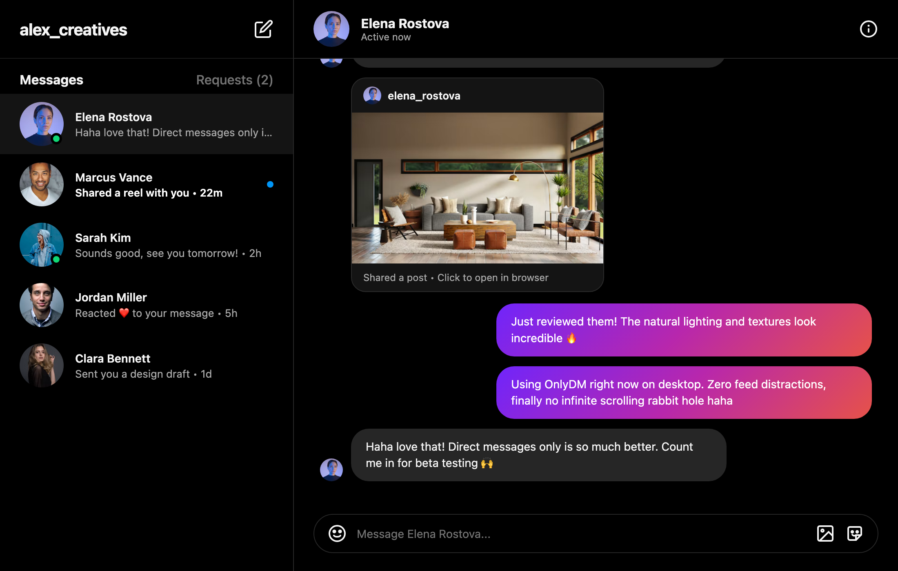

# OnlyDM — Desktop Client for Instagram DM

<p align="center">
  
</p>

<p align="center">
  <strong>OnlyDM is a lightweight desktop client for Instagram DM.</strong>
</p>

<p align="center">
  <a href="https://github.com/PW486/only-dm/releases"></a>
  <a href="LICENSE"></a>
  <a href="https://tauri.app/"></a>
  <a href="https://www.rust-lang.org/"></a>
  
</p>

---

## Overview

Most people open Instagram on their desktop just to reply to urgent direct messages, only to lose an hour falling into an algorithmic feed spiral.

**OnlyDM** changes that. Built on **Tauri v2** and **Rust**, OnlyDM provides a blazing-fast, distraction-free desktop client dedicated strictly to direct messaging. No explore feed, no endless reels, and no background resource hogs.

<p align="center">
  
</p>

---

## ✨ Features

- **Direct Messages Only**: Automatically redirects home feed visits back to `/direct/inbox/`. Keeps you locked into messaging without algorithmic temptations.
- **Featherlight Footprint**: Consumes under **50MB of RAM** (up to 10× lighter than typical Electron wrappers) with a **~5MB installer bundle**.
- **Distraction-Free Workspace**: Automatically removes unnecessary side navigation panels, bottom paddings, and noisy promotion banners.
- **Quiet & Calm Messaging**: Suppresses unsolicited incoming ringtones and noisy call prompts while preserving normal media playback and audio clips.
- **Native OS Integration**: Native macOS app menus, keyboard shortcuts, window state preservation, and localized session management.
- **External Link Safety**: External web links and user profiles automatically launch in your primary default browser to keep your messaging view intact.
- **Privacy-Preserving**: Communicates directly with official Instagram endpoints. No intermediate proxy, no data tracking, and no external telemetry servers.

---

## ⚡ Performance Comparison

| Metric | OnlyDM (Tauri v2 + Rust) | Typical Electron Client |
| :--- | :--- | :--- |
| **Idle Memory Usage** | **~35 MB – 55 MB** | 400 MB – 850 MB |
| **Installer Size (macOS)** | **~4.9 MB (.dmg)** | 110 MB – 180 MB |
| **Cold Startup Time** | **< 400 ms** | 2.5 s – 4.0 s |
| **Binary Security** | Rust memory safety | Node.js / Chromium runtime |

---

## 📥 Installation

### Pre-built Binaries

Download the latest release for your operating system from the **[Releases](https://github.com/PW486/only-dm/releases)** page:

- **macOS (Apple Silicon / Intel)**: `OnlyDM_0.1.2_aarch64.dmg`
- **Windows**: Coming soon in upcoming CI workflow (`.msi` / `.exe`)
- **Linux**: Coming soon (`.deb` / `.AppImage`)

> **macOS first launch:** After dragging `OnlyDM.app` into `/Applications`, try opening it. If macOS blocks the app, run this command in Terminal, then open OnlyDM again:
>
> ```bash
> sudo xattr -r -d com.apple.quarantine /Applications/OnlyDM.app
> ```
>
> Enter your Mac account password when prompted (Terminal does not show the characters as you type).

---

## 🛠️ Building from Source

### Prerequisites

1. **Rust & Cargo**: Latest stable toolchain installed via [rustup](https://rustup.rs/)
2. **Node.js**: Node 18+ and npm
3. **OS Build Tools**:
   - macOS: Xcode Command Line Tools (`xcode-select --install`)
   - Linux: `libwebkit2gtk-4.1-dev` (or `libwebkit2gtk-4.0-dev`), `build-essential`, `curl`, `wget`, `file`, `libssl-dev`, `libgtk-3-dev`, `libayatana-appindicator3-dev`, `librsvg2-dev`
   - Windows: Microsoft C++ Build Tools & WebView2 runtime

### Build Steps

```bash
# 1. Clone the repository
git clone https://github.com/PW486/only-dm.git
cd only-dm

# 2. Install dependencies
npm install

# 3. Run in development mode
npm run dev

# 4. Build a production bundle
npm run build
```

The compiled binary and distribution bundles will be located in:
```text
src-tauri/target/release/bundle/
```

---

## 🧩 Architecture

OnlyDM utilizes **Tauri v2**, combining a lightweight Rust host shell with native system webviews:

```text
┌────────────────────────────────────────────────────────┐
│                        OnlyDM                          │
│                                                        │
│  ┌─────────────────────────┐  ┌─────────────────────┐  │
│  │     Native Rust Host    │  │  Client Injections  │  │
│  │  - App Menu & Windowing │  │  - Feed Interceptor │  │
│  │  - Safe Navigation Lock │  │  - Layout Cleaner   │  │
│  │  - Native User-Agent    │  │  - Sound Suppressor │  │
│  └────────────┬────────────┘  └──────────┬──────────┘  │
│               │                          │             │
│               ▼                          ▼             │
│  ┌──────────────────────────────────────────────────┐  │
│  │       Native Webview (WebKit / WebView2)         │  │
│  │         https://www.instagram.com/direct/        │  │
│  └──────────────────────────────────────────────────┘  │
└────────────────────────────────────────────────────────┘
```

---

## 🤝 Contributing

Contributions, bug reports, and suggestions are welcome!
Feel free to open an [Issue](https://github.com/PW486/only-dm/issues) or submit a Pull Request.

1. Fork the Project
2. Create your Feature Branch (`git checkout -b feature/AmazingFeature`)
3. Commit your Changes (`git commit -m 'feat: add amazing feature'`)
4. Push to the Branch (`git push origin feature/AmazingFeature`)
5. Open a Pull Request

---

## 📄 License

Distributed under the **MIT License**. See [`LICENSE`](LICENSE) for more details.

---

## ⚠️ Disclaimer

**OnlyDM** is an independent open-source project and is **not** affiliated, associated, authorized, endorsed by, or in any way officially connected with Instagram, Meta Platforms, Inc., or any of their subsidiaries or affiliates. All product and company names are trademarks™ or registered® trademarks of their respective holders.
